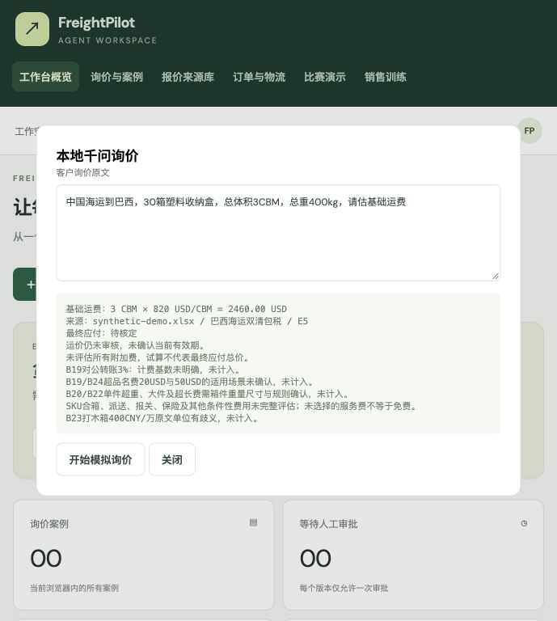

# 11 月 20 日工作台试算记录

Mac 实测版本 `370afe5`。从 FreightPilot 工作台提交中国海运到巴西的询价，30 箱塑料收纳盒，总体积 3 CBM，总重 400 kg。本地 LM Studio 中的千问调用分类工具得到“普货一类”。操作员确认本次试算后，Python 工具读取合成表 synthetic-demo.xlsx 的“巴西海运双清包税”页 E5，页面显示基础运费 3 × 820 = 2,460.00 USD，最终应付待核定。此次由工作台直接连接 LM Studio。订单、持久审批及外部业务执行仍待联调。

## 组员本机复现

1. 获取并切换到 `codex/local-customer-inquiry` 分支。
2. 按[仓库说明](../../../README.md)准备 Python、Node 和合成数据。
3. 在本机 LM Studio 加载 `qwen3.5-9b-mlx` 并启动本地服务（端口 1234）。
4. 从仓库根目录运行 `npm run workbench`，打开 http://127.0.0.1:4178/ ，在概览选择“本地千问询价”。这个地址指向访问者自己的电脑。
5. 输入上述客户需求，核对来源、数量和附加服务后确认试算。核对基础运费和来源单元格。Windows 工作台和模型联动仍待组员复测。
